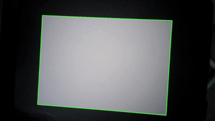
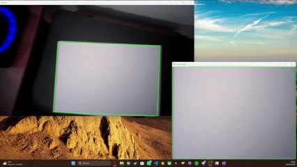
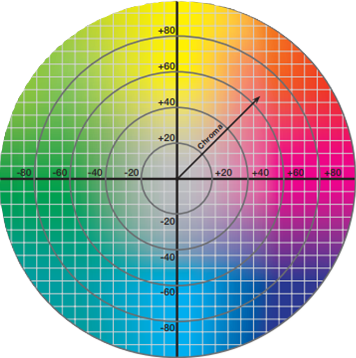
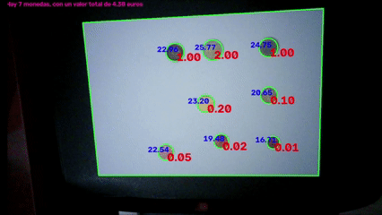
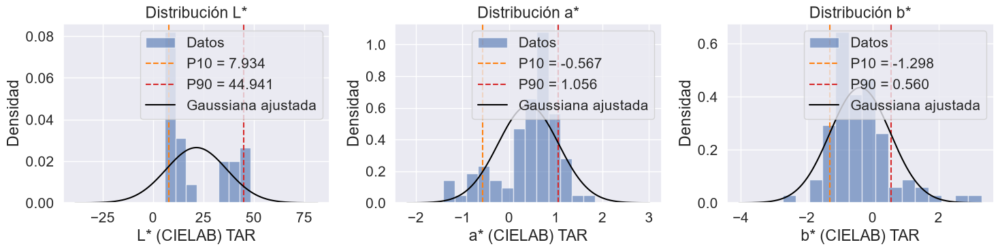
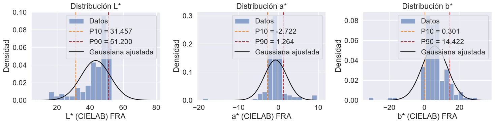
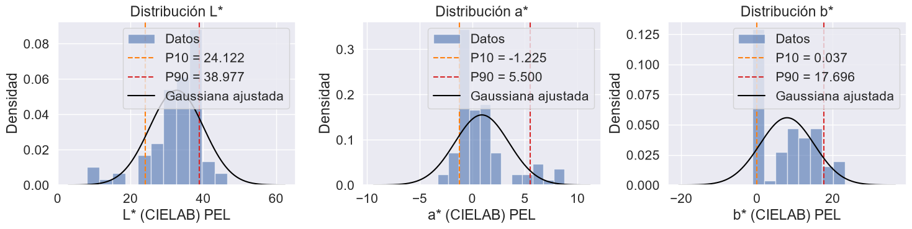
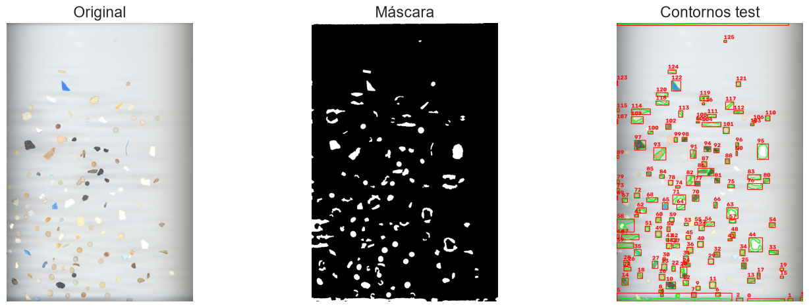

# Práctica 3. Detección y reconocimiento de formas

## Práctica desarrollada por:

- Juan Francisco Almeida Santana, [Github](https://github.com/kikoalmtana)
- Texenery Bordón Rodríguez, [Github](https://github.com/texem4k)
## Contenidos

- **Descripción** 
- **Planteamiento de cada tarea**
- **Conversaciones con IA**

## Descripción  

El objetivo de esta práctica es aprender a extraer características geométricas y visuales de objetos presentes en imágenes para clasificarlos de forma autmática sin usar modelos de aprendizaje profundo.

Las tareas realizadas han sido las siguientes:

- Determinar la cantidad de dinero y monedas presentes en una imagen captada con una webcam

- Desarrollar un método de detección y clasificación de partículas de Alquitrán, Pellet y Fragment en una imagen a raíz de características geométricas 

## Planteamiento de cada tarea

### Tarea 1: Detección y conteo de monedas en tiempo real

Para esta tarea se pide crear un demostrador en tiempo real que, a partir de una webcam, determine el dinero total en la escena. A pesar de que en el enunciado se recomienda empezar partiendo de las imágenes de las monedas al ser una imagen ideal.  
Hemos considerado empezar directamente en el demostrador en vivo que genera detecciones precisas a pesar de depender esencialmente en la iluminación de la escena.

El planteamiento a rasgos generales es usar un folio o superficie fija como referencia (en este caso un folio) para obtener el diametro a una escala "estable".  
Esto implica en usar un cambio de perspectiva para mantener esa escala aunque la cámara se aleje, se acerque o cambie el grado de inclinación.

Por ello, podemos diseccionar la tarea en secciones características:

1) Detección del folio  
2) Transformación de perspectiva, manteniendo una escala "fija" en el folio.
3) Obtener el centro y el radio de cada moneda usando la matriz de transformación mediante mínimos cuadrados, así cómo el color con estos mismos valores
4) Clasificar y trackear la moneda, así como sus atributos durante 30 frames, para obtener una medida más precisa de atributos
5) Mostrar el diametro, el contorno y el valor de cada moneda

### Detección del folio

Para la detección de folio, se usa una función auxiliar llamada `find_whitepaper(...)` donde se le pasa el *frame* original y el mismo *frame* pasado a gris con *blur* para eliminar ruido.  
En general la función umbraliza `blur` y detecta los contornos. Como buscamos un folio, se busca el cortorno con mayor área, además con el perímetro y una aproximación poligonal podemos obtener una figura que represente el folio,  
que deberá tener **4 puntos**, uno para cada esquina.

Estos 4 puntos serán usados ahora para crear un nuevo *frame* que contega sólo el folio. Aquí se muestra la detección del folio:

 

### Transformación de perspectiva, manteniendo una escala "fija" en el folio.

Tras obtener los puntos de las esquinas del folio. Se detectan las posibles monedas con `cv2.HoughCircles(...)` y con los puntos del folio se determina si está apaisado o en vertical usando la norma entre los puntos.

Tras esto, se crea una matriz con los nuevos puntos del frame que contendrá el folio y se le pasa a la función `cv2.getPerspectiveTransform(...)` para conseguir la matriz de transformación y con  
`cv2.wrapPerspective(...)` obtenemos el frame transformado.

Aquí se muestra la transformación del *frame* al folio, enfocandose en el folio:

 

### Obtener el centro y el radio de cada moneda usando la matriz de transformación mediante mínimos cuadrados, así cómo el color con estos mismos valores

Para cada moneda, obtenemos sus coordenadas **(x,y)** y su radio **r**. Y llamamos a la función `measure_coin(..)` donde, entre otros, se obtiene una 180 puntos alrededor del centro junto con el radio para usarlos en la  
aproximación mediante mínimos cuadrados, esto con la finalidad de obtener el centro y radio adaptado a la escala del *frame* transformado. Así se obtiene un diámetro más preciso debido al anclaje a la escala del *frame* transformado.

Seguidamente se puede obtener el color usando el *frame* original y medidas de circulo originales, usando la función `color_moneda(...)`. En esta función definimos un **ROI** del cuadrante inferior derecha de la moneda,  
que será suficiente para este proceso. Entre otras operaciones, se realizan las siguientes:

- Normalizan los colores del ROI
- Pasar a formato LAB
- Crear máscaras para el centro y para el anillo (0-45% del radio y 82-95% del radio respectivamente)

En la parte final de este proceso, se calcula el **croma** de la máscara central y la de anillo, y se comparan de forma relativa mediante **logaritmo natural**, ya que tienen **diferencias proporcionales**.  
De forma que da igual si se compara la el centro sobre el anillo u al revés, ya que dan los mismos valores pero con signo distinto. Las comparaciones para saber el color de la moneda son las siguientes:

- Si el **croma supera** cierto umbral entonces la moneda es de **bimetal**, es decir de 1-2€.
- Si no supera un umbtral mínimo, entonces la moneda es de un color muy neutro y no se puede saber el color.
- Para diferenciar si es de cobre u otro, se cálcula el ángulo de corte entre los valores a y b de la anilla. 

Para en ángulo de corte, imagine que el espacio de color de LAB es la siguiente circunferencia:

Como podrás observar, cuanto mayor ángulo de corte más se acerca a **oro/amarillo** (hasta ~90 grados), y cuanto menor el color será más **rojizo**. Por ello, si el ángulo de corte no supera cierto umbral, será cobre, sino será oro.

 

### Clasificar y trackear la moneda, así como sus atributos durante 30 frames, para obtener una medida más precisa de atributos

Con el color, se clasifican las monedas mediante **diccionarios**. Uno por cada **color** (Cobre, Oro Bimetal), esto permite obtener el valor de forma precisa eligiendo aquel cuyo diámetro se acerque más. Una vez obtenido el valor actual,  
junto con el diámetro corregido y color actual, se crea un objeto **Track** que representa una moneda única, que contiene varias listas con los atributos de la moneda acumulados en varios frames.  
Cuando un track tiene más de 10 diametros/frames, se obtiene el **diámetro mediano**, el **color** más común y el **valor** más común.

 

### Mostrar el diametro, el contorno y el valor de cada moneda

Aquí sólo queda representar la información, así pues así se vería una prueba con varias monedas:

Como se puede observar, no es preciso al 100% y desplazarlo más cerca de la luz puede generar un comportamiento **errático**. Se podría solucionar en un entorno ideal donde la iluminación sea **difusa** y   suficiente para que no genere reflejos ni sombras laterales.

 

### Tarea 2: Clasificación de partículas sin aprendizaje profundo

Esta tarea consiste en crear un clasificador de partículas de distintos tipos (Alquitran, Fragment y Pellet) para una imagen sin usar aprendizaje profundo:

La tarea principalmente tiene 2 partes:

1) La primera consiste en desarrollar un método de segmentación y detección de partículas en una imagen
2) La segunda consiste en desarrollar un método de clasificación en base a características encontradas en la imagen

En este documento se explica de forma resumida los métodos utilizados y el procedimiento que se llevó a cabo para completar esta tarea, los detalles y explicaciones detalladas acerca de los análisis de las características y de las decisiónes de los umbrales elegidos para la clasificación se encuentran en el cuaderno de la tarea junto al código ejecutable, donde se realizan comparaciones y se muestran tablas con datos de interés para la tarea.

### Método de segmentación y detección

Para encontrar las partículas presentes en una imagen se han desarrollado diferentes métodos que combinándolos, son capaces de extraer las partículas presentes en una imagen, para ello nos centramos en la detección de contornos en la imagen y para facilitar la detección se aplican máscaras binarias y distintos filtros:

- Método "segmentar": es un método implementado que dada una imagen y ciertos parámetros de configuracion (ajustados mediante prueba y error), aplica una máscara binaria adaptativa en una imagen en escala de grises (ADAPTIVE_THRESH_GAUSSIAN_C).

- Método "extraer_partículas": es un método implementado que recibe la máscara binaria que devuelve el método "segmentar", que se encarga de detectar los contornos en esta máscara y luego extraer las características del contorno, como su posición y otros valores interesantes.

- Método "características_contorno": es un método implementado y que se usa en el método "extraer_partículas" que dado un contorno, devuelve sus características.

Combinando todos estos métodos mas alguno mas implementado de visualización (que no interesa en la explicación de la extracción de partículas) se obtienen estos resultados:

Con esto ya podríamos segmentar partículas en una imagen y extraer características de las mismas.

### Método de clasificación en base a umbrales

Dada la limitación de no poder usar aprendizaje profundo para detectar y clasificar, se ha optado por definir diferentes umbrales en base a las características físicas de las partículas en las imagenes para su clasificación. Estos umbrales se han definido en torno a las siguientes características:

- **Circularidad de la partícula:** La circularidad define como es de circular la forma de una particula, de 0 (nada) a 1 (círculo perfecto). Para ello se ha estudiado los valores de circularidad de las partículas en sus distintas imágenes de entrenamiento.

En estas gráficas se observan los diferentes resultados en el estudio de la circularidad de las distintas poblaciones de partículas en las imagenes de entrenamiento, a simple vista se puede ver que esta característica nos sirve para diferenciar Fragment de Alquitran y Pellet (porque tienen a una circularidad mas variada y que tiende a ser menor) y que las "más circulares" con diferencia son las partículas de Fragment.

- **Color de la partícula en Lab**: El modelo de color Lab es un modelo de color pensado para describir todos los colores que el ojo humano puede ver, esto lo hace utilizando un componente de "Luminosidad" (L) y dos ejes que miden el croma de la partícula (a* y b*).

Observando las diferencias en esta representación del color entre las partículas podemos apreciar que especialmente las partículas de alquitran tienden a tener valores mas bajos de L valores de a* y b* cercanos a 0, al contrario que las de Pellet y Fragment.

Estudiando estas dos características en las imagenes de ejemplo podemos establecer umbrales que podemos aplicar en cada particula detectada tras segmentar la imagen de prueba para clasificarla entre las 3 clases.

### Resultados

Tras procesar la imagen de test utilizando este método de segmentación descrito podemos apreciar ruido en la segmentación y detección de particulas, debido a irregularidades en el color de fondo de la imagen original, además de partículas que se quedan "fuera de la máscara".

De las 120 partículas presentes en la imagen de test, se detectan 127, pero sólo se logran emparejar correctamente 62, lo que da un acierto de poco mas del 50% en la detección de partículas.

Por otro lado en la clasificación utilizando umbrales se ha logrado un 75% de acierto en la clasificación de las partículas detectadas correctamente en la segmentación.

## Conversaciones con IA

- Conversaciones con Claude, 
    - Finalidad -> Obtener y desarrollar un primer planteamiento inicial usando un modelo de Aprendizaje Automático (RandomForestClassifier), descartado posteriormente
    - [Enlace](https://claude.ai/share/ef804d83-414a-40dc-a802-4e8c6affd69c)

    - Finalidad -> Desarrollo del concepto actual de clasificador (basado en umbrales)
    - [Enlace](https://claude.ai/share/8da05385-e3bd-4a30-b957-1d9790a536f4)

    - Finalidad -> Posible enfoque para monedas y uso para su desarrollo en gran parte de la tarea.
    - [Enlace](https://claude.ai/share/34a920dd-40e7-4c11-8c3e-d8ffbc8a7259)