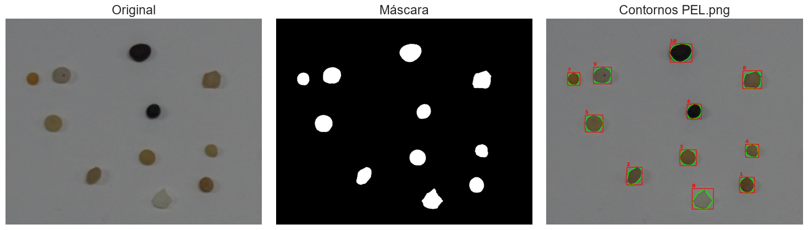
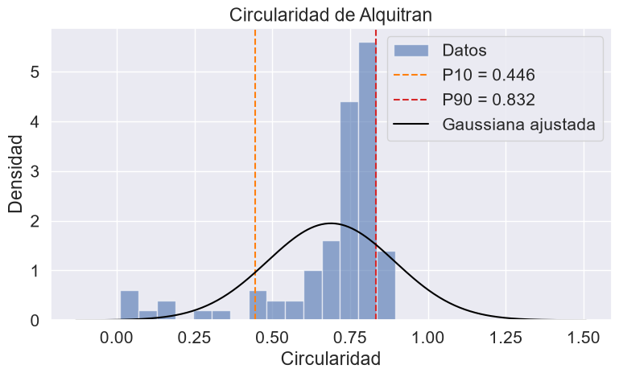
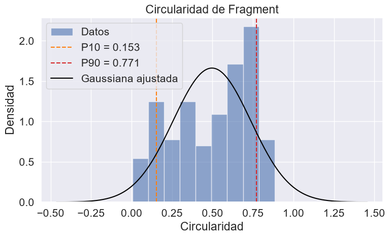
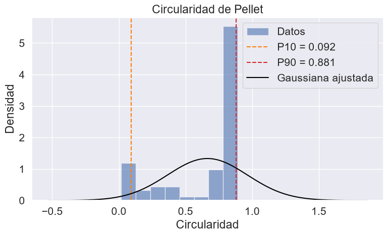

# Práctica 2. Funciones básicas de OpenCV

## Práctica desarrollada por:

- Juan Francisco Almeida Santana, [Github](https://github.com/texem4k)
- Texenery Bordón Rodríguez, [Github](https://github.com/texem4k)
## Contenidos

- **Descripción** 
- **Planteamiento de cada tarea**
- **Conversaciones con IA**
- **Referencias**

## Descripción  

Al igual que en la práctica anterior, se han llevado a cabo una serie de ejercicios básicos para una toma de contacto con la librería OpenCV, así cómo acceder y modificar el valor de un pixel, umbralizados y entre otros. Las tareas llevadas a cabo son las siguientes:

- Realizar la cuenta de píxeles blancos por fila. Determinar el valor máximo de píxeles blancos para filas, mostrando el nº de filas y sus respectivas posiciones para aquellas filas que cuyo cantidad de balnc pixeles blanco sean mayores al 90% del valor máximo obtenido. Resaltar estas filas.

- Aplicar el umbralizado de la imagen resultante de Sobel (8 bits) y realizar el conteo de filas y columnas parecido al del ejercicio anterior. Destacar aquellas filas y columnas cuyos porcentaje de blanco supere el 90% del máximo. Remarcar las filas y columnas que cumplan dicha condición. Comparar resultados entre Sobel y Canny.

- Tras ver los vídeos planteados, proponer una demostración de la parte de procesamiento de la imagen, tomando como punto de partida alguna de los videos. Se implementaron dos demos: un sistema de zoom centrado en la cara detectada por el modelo YUNet, y otra que redimensiona la imagen directamente hacia el centro de cada cara detectada.

## Planteamiento de cada tarea
  
### Tarea 1: parte de texe

### Tarea 2: Clasificación de partículas sin aprendizaje profundo

Esta tarea consiste en crear un clasificador de partículas de distintos tipos (Alquitran, Fragment y Pellet) para una imagen sin usar aprendizaje profundo:

La tarea principalmente tiene 2 partes:

1) La primera consiste en desarrollar un método de segmentación y detección de partículas en una imagen
2) La segunda consiste en desarrollar un método de clasificación en base a características encontradas en la imagen

### Método de segmentación y detección

Para encontrar las partículas presentes en una imagen se han desarrollado diferentes métodos que combinándolos, son capaces de extraer las partículas presentes en una imagen, para ello nos centramos en la detección de contornos en la imagen y para facilitar la detección se aplican máscaras binarias y distintos filtros:

- Método "segmentar": es un método implementado que dada una imagen y ciertos parámetros de configuracion (ajustados mediante prueba y error), aplica una máscara binaria adaptativa en una imagen en escala de grises (ADAPTIVE_THRESH_GAUSSIAN_C)

- Método "extraer_partículas": es un método implementado que recibe la máscara binaria que devuelve el método "segmentar", que se encarga de detectar los contornos en esta máscara y luego extraer las características del contorno, como su posición y otros valores interesantes

- Método "características_contorno": es un método implementado y que se usa en el método "extraer_partículas" que dado un contorno, devuelve sus características

Combinando todos estos métodos mas alguno mas implementado de visualización (que no interesa en la explicación de la extracción de partículas) se obtienen estos resultados:

Con esto ya podríamos segmentar partículas en una imagen y extraer características de las mismas.

### Método de clasificación en base a umbrales

Dada la limitación de no poder usar aprendizaje profundo para detectar y clasificar, se ha optado por definir diferentes umbrales en base a las características físicas de las partículas en las imagenes para su clasificación. Estos umbrales se han definido en torno a las siguientes características:

- **Circularidad de la partícula:** La circularidad define como es de circular la forma de una particula, de 0 (nada) a 1 (círculo perfecto). Para ello se ha estudiado los valores de circularidad de las partículas en sus distintas imágenes de entrenamiento

En estas gráficas se observan los diferentes resultados en el estudio de la circularidad de las distintas poblaciones de partículas en las imagenes de entrenamiento

## Conversaciones con IA

- Conversación con Claude Sonnet 5, 
    - Finalidad -> Adaptar un código para realizar el zoom obtenido de rebuscar en internet
    - [Enlace](https://claude.ai/share/d4449072-895e-4dba-a371-08a822129108)

## Referencias

- Enlace a una lista de reproducción de videos sobre OpenCV, se han visto un par de videos para entender la dinámica de la librería
    - [Enlace](https://www.youtube.com/playlist?list=PLzMcBGfZo4-lUA8uGjeXhBUUzPYc6vZRn)
- Link de la página donde se obtuvo la función *zoom_hacia_punto* original
    - [Enlace](https://learnopencv.com/center-stage-for-zoom-calls-using-mediapipe/)

- Vídeos de referencia para la Tarea 3:
    - [My little piece of privacy](https://www.niklasroy.com/project/88/my-little-piece-of-privacy)
    - [Messa di voce](https://youtu.be/GfoqiyB1ndE?feature=shared)
    - [Virtual air guitar](https://youtu.be/FIAmyoEpV5c?feature=shared)
