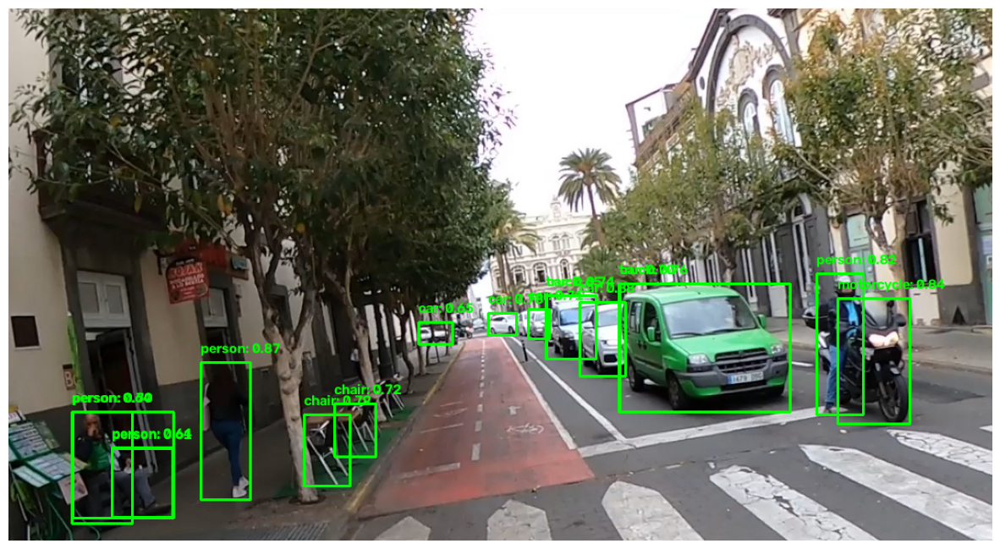
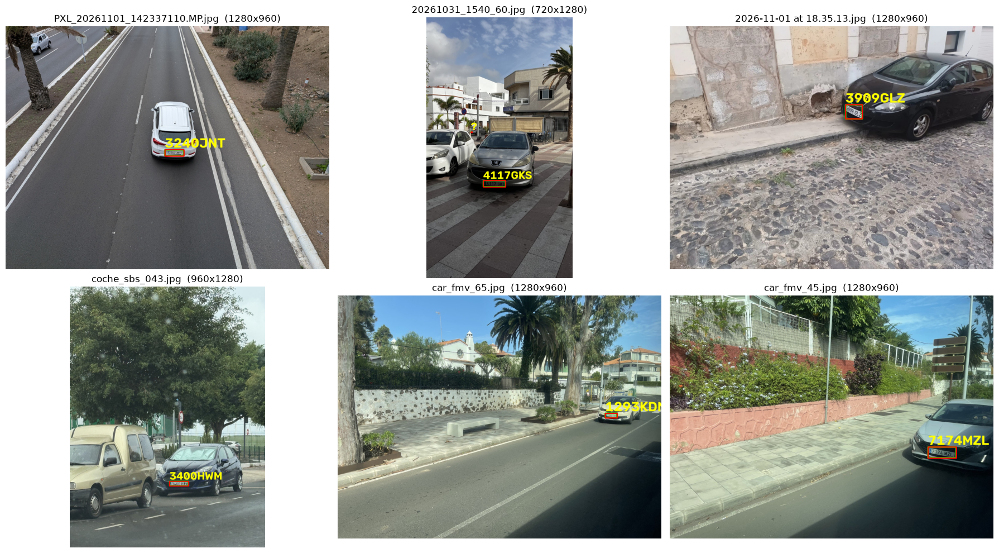

# Prácticas 4 y 4b: Detección de vehículos y matrículas

## Práctica desarrollada por:

- Juan Francisco Almeida Santana, [Github](https://github.com/kikoalmtana)
- Texenery Bordón Rodríguez, [Github](https://github.com/texem4k)

## Contenidos

- **Descripción** 
- **Planteamiento de la práctica 4**
- **Planteamineto de la práctica 4b**
- **Conversaciones con IA**

## Descripción  

Las prácticas 4 y 4b tienen como objetivos aprender a utilizar modelos de detección de objetos en tiempo real, así como entrenarlos para fines concretos y a utilizar modelos de OCR para extraer textos de imágenes.

El objetivo final de la práctica es crear un pipeline en el que entra un video que es procesado por 3 modelos:

1) El primero modelo se encarga de detectar vehículos de distintos tipos en la imagen y personas
2) El segundo modelo se encarga exclusivamente de buscar matrículas en la imagen
3) El tercer modelo es un OCR que toma las matrículas detectadas por el segundo modelo y las lee

De esta forma se obtiene finalmente un prototipo capaz de procesar un video y extraer la información solicitada para la entrega de la práctica.

## Planteamiento de las actividades de la práctica

El desarrollo de la práctica se divide en diferentes fases donde se fueron añadiendo los distintos modelos y se fueron probando a medida avanzaba el desarrollo del proyecto.

### Índice

1) Carga del modelo base RT-DETR (COCO)
2) Importación, división y visualización del dataset
3) Entrenamiento del modelo de detección de matrículas y evaluación
4) Detección de vehículos y matrículas en un video
5) Comparativa entre modelos OCR (Florence-2 base y EasyOCR)
6) Entrenamiento de Florence-2 con matrículas del dataset
7) Detección de vehículos y lectura de matrículas en un video
8) Apartados adicionales

## 1. Carga del modelo base RT-DERT (COCO)

Este punto corresponde a la fase 0, en la cual se clonó el modelo DETRv2-L, preentrenado con COCO y se prueba con una imagen de test



Posteriormente se limitarán sus clases a únicamente los distintos tipos de vehículo que es capaz de detectar por defecto este modelo y para la detección de matrículas se usará un segundo modelo, más pequeño, el cual se entrenará para esta tarea en específico.

Para ello es necesario cargar un dataset de entrenamiento para matrículas.

## 2. Importación, división y visualización del dataset

Este punto corresponde a la fase 1, donde se importa un dataset de matrículas elaborado por los alumnos de la asignatura de Visión por Computador (curso 2026) y se prepara y segmenta para trabajar con él.

El dataset cuenta con 2183 imágenes con sus respectivas anotaciones en formato json, teniendo el siguente formato:

```json
[
    {
        rectangle: [x_center, y_center, width, height],
        plate: "0000AAA"
    },
    {
        rectangle: [x_center, y_center, width, height],
        plate: "None"
    }
]
```

En esta fase se preparan en el directorio del proyecto, partiendo de un directorio local donde se encuentra previamente descargado el dataset, directorios donde se almacenarán dichas imágenes y anotaciones.

También se procesan las imágenes para corregir la orientación indicada en sus metadatos EXIF y mantener alineadas las anotaciones. Las coordenadas de las cajas se convierten al formato COCO para que el dataset sea compatible con RT-DETR y pueda utilizarse para entrenar y evaluar el modelo.

Una vez realizado lo anterior, el conjunto resultante de imágenes se divide en 3 subconjuntos:

- Train (60 % del dataset)
- Test  (25 % del dataset)
- Val   (15 % del dataset)




## 3. Entrenamiento del modelo de detección de matrículas y evaluación

Este punto corresponde a las Fases 2 y 3 en las que se prepara el entrenamiento del modelo detector de partículas y se ejecuta el entrenamiento del modelo.

En la Fase 2 se importa un modelo RT-DETRv2-5, más pequeño que el modelo base, con backbone ResNet-18 (el modelo base usa PResNet-50 como arquitectura interna) con sus pesos oficiales de preentreno. La configuración del modelo se encuentra en los ficheros ubicados en el directorio /config.

En la Fase 3 es el punto donde se entrena al modelo seleccionado en la Fase 2, se entrena ejecutando el siguiente comando en desde una terminal entro del entorno VC_P4 creado para la práctica en el directorio del proyecto:

```bash
> python RT-DETR/rtdetrv2_pytorch/tools/train.py -c configs/rtdetrv2_r18vd_120e_coco.yml --use-amp --seed 0
```

El entrenamiento consiste en 50 etapas donde recibe lotes de 4 imágenes de entrenamiento y 8 imágenes de validación, fijando la entrada de datos en 800px x 800px, a las que se aplican cambios fotometricos y recortes aleatorios (estos cambios se dejan de aplicar en las 3 últimas etapas para terminar el ajuste con imágenes menos alteradas)

El entrenamiento se realizó utilizando una targeta gráfica Nvidia RTX 3050 de GB's 8GB y el entrenamiento duró cerca de 2 horas. Al finalizar este punto se obtienen pesos ajustados a la detección de matrículas para este modelo.

## 4. Detección de vehículos y matrículas en un video


## 5. Comparativa entre modelos OCR (Florence-2 base y EasyOCR)


## 6. Entrenamiento de Florence-2 con matrículas del dataset


## 7. Detección de vehículos y lectura de matrículas en un video


## 8. Apartados adicionales