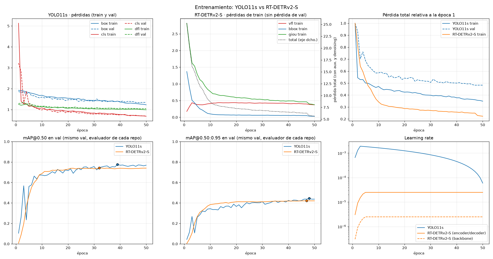
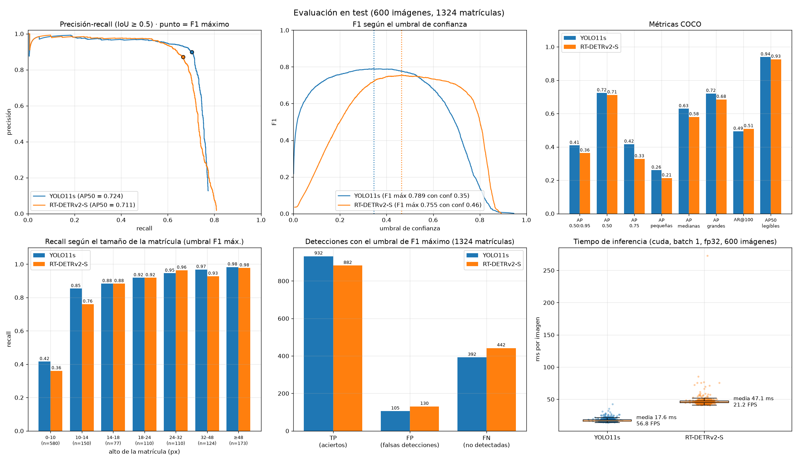
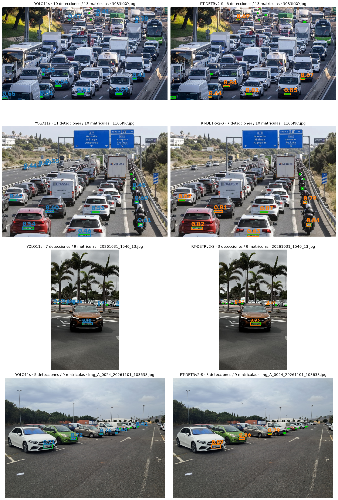

# Prácticas 4 y 4b: Detección de vehículos y matrículas

## Práctica desarrollada por:

- Juan Francisco Almeida Santana, [Github](https://github.com/kikoalmtana)
- Texenery Bordón Rodríguez, [Github](https://github.com/texem4k)

## Contenidos

- **Descripción** 
- **Planteamiento de la práctica 4**
- **Planteamineto de la práctica 4b**
- **Conversaciones con IA**

## Descripción  

Las prácticas 4 y 4b tienen como objetivos aprender a utilizar modelos de detección de objetos en tiempo real, así como entrenarlos para fines concretos y a utilizar modelos de OCR para extraer textos de imágenes.

El objetivo final de la práctica es crear un pipeline en el que entra un video que es procesado por 3 modelos:

1) El primero modelo se encarga de detectar vehículos de distintos tipos en la imagen y personas
2) El segundo modelo se encarga exclusivamente de buscar matrículas en la imagen
3) El tercer modelo es un OCR que toma las matrículas detectadas por el segundo modelo y las lee

De esta forma se obtiene finalmente un prototipo capaz de procesar un video y extraer la información solicitada para la entrega de la práctica.

Se adjunta link de [Google Drive](https://drive.google.com/drive/folders/1Z01LCtcMmDV7K0XNn0mcDfsvk4-wujTI?usp=sharing) con el dataset original sin modificar

## Planteamiento de las actividades de la práctica

El desarrollo de la práctica se divide en diferentes fases donde se fueron añadiendo los distintos modelos y se fueron probando a medida avanzaba el desarrollo del proyecto.

### Índice

1) Carga del modelo base RT-DETR (COCO)
2) Importación, división y visualización del dataset
3) Entrenamiento del modelo de detección de matrículas y evaluación
4) Detección de vehículos y matrículas en un video
5) Comparativa entre modelos OCR (Florence-2 base y EasyOCR)
6) Entrenamiento de Florence-2 con matrículas del dataset
7) Detección de vehículos y lectura de matrículas en un video
8) Apartados adicionales

## 1. Carga del modelo base RT-DERT (COCO)

Este punto corresponde a la fase 0, en la cual se clonó el modelo DETRv2-L, preentrenado con COCO y se prueba con una imagen de test


Posteriormente se limitarán sus clases a únicamente los distintos tipos de vehículo que es capaz de detectar por defecto este modelo y para la detección de matrículas se usará un segundo modelo, más pequeño, el cual se entrenará para esta tarea en específico.

Para ello es necesario cargar un dataset de entrenamiento para matrículas.

## 2. Importación, división y visualización del dataset

Este punto corresponde a la fase 1, donde se importa un dataset de matrículas elaborado por los alumnos de la asignatura de Visión por Computador (curso 2026) y se prepara y segmenta para trabajar con él.

El dataset cuenta con 2183 imágenes con sus respectivas anotaciones en formato json, teniendo el siguente formato:

```json
[
    {
        rectangle: [x_center, y_center, width, height],
        plate: "0000AAA"
    },
    {
        rectangle: [x_center, y_center, width, height],
        plate: "None"
    }
]
```

En esta fase se preparan en el directorio del proyecto, partiendo de un directorio local donde se encuentra previamente descargado el dataset, directorios donde se almacenarán dichas imágenes y anotaciones.

También se procesan las imágenes para corregir la orientación indicada en sus metadatos EXIF y mantener alineadas las anotaciones. Las coordenadas de las cajas se convierten al formato COCO para que el dataset sea compatible con RT-DETR y pueda utilizarse para entrenar y evaluar el modelo.

Una vez realizado lo anterior, el conjunto resultante de imágenes se divide en 3 subconjuntos:

- Train (60 % del dataset)
- Test  (25 % del dataset)
- Val   (15 % del dataset)


## 3. Entrenamiento del modelo de detección de matrículas y evaluación

Este punto corresponde a las Fases 2 y 3 en las que se prepara el entrenamiento del modelo detector de matrículas y se ejecuta el entrenamiento del modelo.

En la Fase 2 se importa un modelo RT-DETRv2-S, más pequeño que el modelo base, con backbone ResNet-18 (el modelo base usa PResNet-50 como arquitectura interna) con sus pesos oficiales de preentreno. La configuración del modelo se encuentra en el fichero `configs/rtdetrv2_r18vd_120e_coco.yml`.

En la Fase 3 es el punto donde se entrena al modelo seleccionado en la Fase 2, se entrena ejecutando el siguiente comando en desde una terminal entro del entorno VC_P4 creado para la práctica en el directorio del proyecto:

```bash
> python RT-DETR/rtdetrv2_pytorch/tools/train.py -c configs/rtdetrv2_r18vd_120e_coco.yml --use-amp --seed 0
```

Para el entrenamiento se ha usado:
- **Modelo**: RT-DETRv2-S: backbone ResNet-18 (`PResNet`, `depth: 18`) + `HybridEncoder` + decoder de 3 capas con 100 *queries*.
  Se parte de los pesos COCO oficiales (`tuning`); la cabeza de 80 clases se descarta sola.
- **Una sola clase**: matrícula (`num_classes: 1`).
- **Resolución**: 800×800 en entrenamiento y validación (`Resize` y `eval_spatial_size: [800, 800]`), sin multiescala,
  para no perder las matrículas pequeñas.
- **Épocas**: 50; las 3 últimas sin aumentos (`policy.epoch: 47`).
- **Batch**: 4 imágenes en entrenamiento y 8 en validación.
- **Aumentos de datos**: `RandomPhotometricDistort` (p = 0.5) y `RandomIoUCrop` (p = 0.8) y `RandomZoomOut` del repo.
- **Optimizador**: AdamW, lr 2.5e-5 (2.5e-6 en el backbone), weight decay 1e-4. Después el lr queda constante (el `MultiStepLR` del repo tiene el hito en la época 1000).
- **EMA** (media móvil exponencial de los pesos, decay 0.9998): suaviza las oscilaciones del entrenamiento.
- **AMP** (precisión mixta) para ahorrar memoria y tiempo.

### 3.1 Proceso de entrenamiento

El entrenamiento guarda sus resultados en `output/res_800/`: el registro por época (`log.txt`), los pesos de la mejor época (`best.pth`) y de la última (`last.pth`), un punto de control cada 10 épocas (`checkpoint00X9.pth`) y los eventos de TensorBoard (`summary/`). Al final de cada época el modelo se evalúa sobre el conjunto de validación con las métricas COCO, y se guarda en `best.pth` la versión que mejor AP 0.50:0.95 obtiene.

Las 50 épocas tardaron **casi 5 horas** (unos 6 minutos por época) en un portátil. La evolución en validación fue la siguiente:

| Época | Pérdida de train | AP 0.50:0.95 | AP 0.50 | AR@100 |
| :---: | :---: | :---: | :---: | :---: |
| 1  | 25.24 | 0.003 | 0.006 | 0.029 |
| 5  | 13.39 | 0.266 | 0.469 | 0.396 |
| 10 | 8.66  | 0.384 | 0.687 | 0.537 |
| 20 | 7.24  | 0.411 | 0.730 | 0.551 |
| 30 | 6.85  | 0.411 | 0.735 | 0.550 |
| 40 | 6.50  | 0.419 | 0.739 | 0.551 |
| **47 (`best.pth`)** | 6.30 | **0.422** | 0.737 | **0.554** |
| 50 | 5.63  | 0.420 | 0.740 | 0.553 |

- **Primeras épocas (1–10):** la etapa de mayor aprendizaje. Durante las primeras ~4 épocas el *learning rate* sube de forma gradual (calentamiento de 1500 iteraciones), y en solo 10 épocas el modelo pasa de no detectar nada a un AP50 de ≈0.69.
- **Épocas intermedias (10–47):** la pérdida sigue bajando poco a poco, pero las métricas apenas mejoran: el AP50 se estabiliza en torno a 0.73–0.74 desde la época 20 y el AP 0.50:0.95 solo sube de 0.41 a 0.42.
- **Últimas épocas (48–50):** al desactivar los aumentos de datos, la pérdida de train cae bruscamente (de 6.3 a 5.6), pero las métricas de validación no mejoran. La mejor época es la 47, con una diferencia despreciable respecto a la 50.

En resumen, el entrenamiento converge sin problemas y sin señales de sobreajuste, aunque el modelo se estanca pronto: a partir de la época 20 la mejora es mínima, por lo que más épocas con este *learning rate* aportarían poco. La diferencia entre AP50 (0.74) y AP 0.50:0.95 (0.42) indica que el modelo encuentra las matrículas, pero sus cajas no se ajustan del todo cuando se exige un IoU alto, algo habitual con objetos tan pequeños.
<br><br>

## 4. Detección de vehículos y matrículas en un video

Este punto corresponde a las Fases 4 y 5. La fase 4 es donde se ejecuta el modelo que acabamos de entrenar sobre las 600 imágenes de test y extraemos métricas COCO para evaluarlo, comparando las detecciones con las cajas reales anotadas.

Se realiza exactamente el mismo preprocesado que la validación del repositorio (las imagenes de redimensionan a 800 x 800 y se escalan a [0, 1]) de forma que devuelve las cajas en píxeles de la imagen original.

El conjunto de imágenes de test cuenta con 757 matrículas, de las cuales 377 se han etiquetado como "legibles" y las 380 como "ilegibles"

Luego se calculan tasas de acierto, error y falso positivo con distintos umbrales de confianza al comparar la caja que devuelve el modelo con la caja real que contiene la matrícula en la imagen de test:

| Umbral | Verdaderos positivos | Falsos positivos | Falsos negativos | Precisión | Recall | F1 | Recall legibles |
| :---: | :---: | :---: | :---: | :---: | :---: | :---: | :---: |
| 0.2 | 499 | 987 | 258 | 0.336 | 0.659 | 0.445 | 0.958 |
| 0.3 | 469 | 317 | 288 | 0.597 | 0.620 | 0.608 | 0.952 |
| 0.4 | 441 | 118 | 316 | 0.789 | 0.583 | 0.670 | 0.950 |
| 0.5 | 420 | 53 | 337 | 0.888 | 0.555 | 0.683 | 0.928 |
| 0.6 | 401 | 24 | 356 | 0.944 | 0.530 | 0.679 | 0.915 |
| 0.7 | 368 | 13 | 389 | 0.966 | 0.486 | 0.647 | 0.886 |


| alto | legibles | ilegibles |
| :--- | :--- | :--- |
| < 4 px | 6/15 (40.0 %) | 20/267 (7.5 %) |
| 4-8 px | 56/63 (88.9 %) | 23/78 (29.5 %) |
| 8-16 px | 83/85 (97.6 %) | 24/32 (75.0 %) |
| 16-32 px | 129/136 (94.9 %) | 2/2 (100.0 %) |
| > 32 px | 76/78 (97.4 %) | 1/1 (100.0 %) |

<br>
En la Fase 5 se integran el detector de vehículos preentrenado y el detector de matrículas entrenado de forma que trabajen juntos sobre un video para detectar personas, vehículos y matrículas. 

Con Supervision y ByteTrack, los vehículos se siguen entre frames y reciben un identificador y las matrículas detectadas se asignan al vehículo que las contiene. El vídeo muestra las detecciones y el conteo en escena y acumulado: 

- El total de vehículos se basa en los identificadores únicos del tracker, mientras que el conteo de matrículas corresponde a los vehículos a los que se asignó una matrícula, no a un seguimiento independiente de cada placa. 

- También se genera un CSV con detecciones por frame y se pixelan personas y matrículas.


## 5. Comparativa entre modelos OCR (Florence-2 base y EasyOCR)

Este punto corresponde a la Fase 6, fase en la que se comparan 2 modelos OCR de distintas arquitecturas para la elección de un modelo OCR para la lectura de matrículas detectadas en un video:

1) **Florence 2 Base:** Es un OCR basado en tecnologías de VLM de implementación nativa de la librería transformers
2) **EasyOCR:** Es un OCR clásico basado en redes neuronales que se implementa de la librería EasyOCR, requiero PyTorch y es un modelo más ligero que Florence 2 Base

Para ambos modelos se ha buscado una configuración de margen y preprocesado mediante padding o estiramiento, y se han evaluado sobre las anotaciones con las cajas reales de las matrículas para no depender de las predicciones del modelo detector de matrículas, obteniendo los siguientes resultados:

**Nota:** Ambos modelos se ejecutaron en una targeta gráfica NVIDIA GeForce RTX 3050 de 8 GB

| **Modelo** |   Florence-2   |   EasyOCR   |
| :--- | :---: | :---: |
| **Tiempo de ejecución** | | |
| Minutos | 54 minutos| 4 minutos |
| Segundos | 40 segundos | 52 segundos |
| **Configuraciones de recorte** |
| Mejor margen | 0.25 | 0.25 |
| Mejor preparación | pad | pad |
| **Tasa de aciertos en TEST** |
| Exactas | 53.6% | 25.0% |
| Aceptadas | 68.6% | 40.2% |
| Precisión aceptadas | 78.1% | 62.2% |
| **Aciertos exactos con distintos tamaños (px de alto)** |
| 0-10 px | 6.7% | 0.0% |
| 10-14 px | 29.2% | 1.8% |
| 14-18 px | 44.0% | 16.0% |
| 18-24 px | 56.3% | 19.5% |
| 24-32 px | 82.7% | 34.7% |
| >32 px | 86.6% | 55.0% |

- **Tiempo de ejecución:** Podemos observar que Florence 2, en comparación, ha tardado 50 minutos más en validarse con las imagenes de test y de val que easyOCR, esto se debe principalmente a que es un modelo mucho más grande con un coste computacional mucho mayor que easyOCR, siendo este último mucho más ligero.

- **Configuraciones de recorte:** En este punto los dos modelos obtienen sus mejores resultados usando un margen de 0.25 y el modo de preparación "pad". Esto se debe a que al dejar un margen más amplio en torno a la matrícula detectada hace más fácil a un OCR leer correctamente el texto. A su vez es más eficiente ajustar las imagenes añadiendo un relleno que mantiene las proporciones originales de la matricula frente (modo padding) a estirar la imagen artificialmente deformando el texto (modo estirar).

- **Tasa de aciertos en VAL:** Florence 2 presenta una tasa de lectura exacta del 53.6% de las matriculas, frente al 25% de easyOCR. Por otro lado Florence 2 también acepta más matrículas que easyOCR y obtiene una mayor precisión que en las aceptadas que easyOCR (acierta el 78.1% de las aceptadas (matrículas leidas con el formato esperado) frente al 62.2% de easyOCR). Podemos concluir que Florence 2 es bastante más robusto.

- **Rendimiento según el tamaño de la matrícula:** Vemos que los dos modelos tienen exactamente la misma tendencia, con resoluciones muy bajas aciertan muy poco en comparación a resoluciones más altas. En el mejor caso para ambos (matriculas de más de 32px de alto) Florence 2 acierta el 86.6% de las matrículas mientras que easyOCR acierta el 55%. Lo interesante en este punto es la tendencia que siguen ambos modelos, que es muy similar.

Podemos concluir que Florence 2 base es un modelo mucho más preciso y robusto en la lectura de matrículas del dataset disponible, pero es cierto que es muchisimo más pesado y complejo, hasta el punto de tardar 50 minutos más que EasyOCR en validarse en el conjunto de datos

## 6. Entrenamiento de Florence-2 con matrículas del dataset

Este punto corresponde a la Fase 7, donde se opta por entrenar al modelo Florence 2 base, que fue el modelo que dio mejor resultado en la comparativa anterior, decara a usarlo junto a los otros dos modelos sobre el video.

Florence-2 base es un OCR genérico: en recortes pequeños "inventa" palabras (RANILES, LARRY). Se afina con los recortes
de **train** (validación con **val** al final de cada época, test solo en la evaluación final), usando como objetivo de la
tarea OCR el texto anotado con el formato 1234 BCD.

- **Qué se entrena**: el codificador-decodificador de texto y el proyector (≈141 M parámetros) y, con ENTRENAR_VISION = True,
  la última etapa del codificador visual (≈30 M). El resto del codificador visual queda congelado.

- **Memoria (GPU de 8 GB, RTX 3050)**: pesos en fp32 con cálculo en bfloat16 (autocast); lotes de BATCH = 2
  con ACCUM = 4 pasos de acumulación (lote efectivo de 8); validación con lotes de VAL_BATCH = 4; etiquetas de longitud
  fija; AdamW de 8 bits si está instalado bitsandbytes (OPTIM_8BIT); los modelos que haya en la GPU pasan a la CPU
  mientras se entrena. Pico medido: ≈4,1 GB sin bitsandbytes.

- **Optimizador**: AdamW, lr 1e-5 (visión) y 2e-5 (texto), calentamiento de 30 pasos y decaimiento lineal. Hasta 15 épocas,
  con parada temprana tras 6 sin mejorar.
  
- **Datos**: recortes de la foto original cuando existe (utils.recoger), con el recorte MARGEN/PREP_MODE de utils.py.
  Se descartan de train las matrículas de menos de 12 px de alto.

- **Aumentos** para parecerse al vídeo: caja de "detector" imperfecta (más o menos margen), reducción de resolución
  (matrícula lejana), desenfoque de movimiento horizontal y cambios de brillo/contraste.

- Se guarda el mejor modelo (exact match en val) en weights/florence2_matriculas.

Ambos modelos se evaluaron sobre los mismos recortes anotados: 463 matrículas en validación y 747 en test. *Exactitud* indica el porcentaje de matrículas leídas completamente bien; *precisión de aceptadas* indica qué proporción de las lecturas aceptadas era correcta. Los cambios se expresan en puntos porcentuales (pp).

| Conjunto | Métrica | Florence-2 base | Florence-2 afinado | Cambio |
| :--- | :--- | ---: | ---: | ---: |
| Validación (463) | Lecturas exactas | 68,3 % | 75,6 % | **+7,3 pp** |
|  | Precisión de aceptadas | 83,8 % | 76,3 % | −7,5 pp |
| Test (747) | Lecturas exactas | 66,7 % | 69,3 % | **+2,7 pp** |
|  | Precisión de aceptadas | 83,3 % | 70,5 % | −12,8 pp |
| Test | Lecturas corregidas por el afinado | — | 40 |  |
| Test | Lecturas empeoradas por el afinado | — | 20 |  |
| Evaluación de test | Tiempo registrado | 129 s | 122 s | −7 s |

En validación, el modelo afinado mejora la exactitud en todos los rangos de tamaño. En test también la mejora en todos ellos, aunque de forma más moderada: la diferencia va de **+0,8 pp** en matrículas de 0–10 px a **+7,1 pp** en los rangos de 10–14 y 18–24 px. En las matrículas de más de 32 px, ambos modelos obtienen sus mejores resultados: 90,4 % el base y 91,9 % el afinado.

El afinado aumenta el número de lecturas completas correctas, pero reduce la precisión entre las lecturas aceptadas, especialmente en test. Por tanto, la mejora en exactitud no significa que cada lectura válida sea más fiable. En un vídeo, donde una lectura incorrecta podría aportar votos, este resultado debe tenerse en cuenta al establecer el umbral de confianza del OCR.

En conjunto, el afinado ofrece una **mejora moderada de exactitud en test** y una mejora mayor en validación, pero a costa de una menor precisión de las lecturas aceptadas. El tiempo de evaluación fue parecido en esta ejecución; la diferencia de siete segundos no permite concluir que el afinado sea más rápido. La resolución de la matrícula sigue siendo importante: ambos modelos leen mucho mejor las placas grandes que las de pocos píxeles.


## 7. Detección de vehículos y lectura de matrículas en un video

Este punto corresponde con la Fase 8 y última del proyecto, es el punto en el que se termina el Pipeline donde el video es procesado por el primer modelo importado (el modelo base) que detecta vehículos y personas, posteriormente pasa por el modelo entrenado para detectar matrículas y por último, pasa por Florence 2 (entrenado en la fase 7) para leer las matriculas detectadas.

Todo lo que se detecte en el video se escribe en un fichero csv que se exporta con todos los datos registrados, además este video sigue contando los elementos que aparecen y que han aparecido en el video. 

Cabe destacar que en este punto además el video se procesa fotograma a fotograma, de forma que la finalizar la ejecución del prototipo, no solo devuelve un csv con todas las detecciones, también devuelve un video donde se puede observar toda la ejecución del modelo y sus detecciones con mayor fluidez que en tiempo real.

## 8. Apartados adicionales/optativos

### 8.1 Comparativa entre RT-DETRv2-S vs YOLO11s para detección de matrículas

Aunque ambos modelos aparentemente sean "similares" por pertencer la categoría *small* de sus respectivas familias, se observará que se diferencian bastante, tanto en el proceso de entrenamiento y recursos usados cómo en la representación de las anotaciones y su forma de uso.

A grandes rasgos, tenemos que RT-DETRv2-S es más grande:

|                   | RT-DETRv2-S | YOLO11s |
| ----------        | ----------- | ------- |
| Parámetros        |    ~20 M    |  9.4 M  |
| Coste de cómputo  |  ~60GFLOPs  | 21.5GFLOPs|
|mAP 50-95          |    47.9     |  47.0  |
|AP50               |    64.9     |x        |
|Anotaciones        |    COCO     |  YOLO  |

<br><br>
Para asegurar un entorno lo más justo posible y en **igualdad de condiciones**, se ha considerado:

- Dividir las imágenes por igual, respetando la distribución 60-15-25, reescalado a 1280x1280px, con la misma semilla en ambos casos descrita previamente con el RT-DETR.
- Entrenar el modelo YOLO11s, a **50 épocas**, con imágenes de **800x800**, con **2 workers**

Además, se debe de hacer la conversión de las anotaciones originales a YOLO.

#### 8.1.1 Entrenamiento de YOLO11s 
<br>
El entrenamiento se lanza desde el notebook con la API de Ultralytics, partiendo de los pesos preentrenados en COCO (`yolo11s.pt`) y con el dataset descrito en `YOLO/train.yaml` (una única clase, `matricula`):

```python
model = YOLO("YOLO/yolo11s.pt")
model.train(data="YOLO/train.yaml", epochs=50, imgsz=800, batch=8, workers=2, seed=0, name="yolo11s_div_rtdetr")
```

**Características del entrenamiento** (`runs/detect/yolo11s_div_rtdetr/args.yaml`):

- **Modelo**: YOLO11s con pesos COCO; la cabeza se adapta automáticamente a 1 clase.
- **Resolución**: 800×800, igual que el RT-DETRv2-S.
- **Épocas**: 50, con `close_mosaic: 10` (las 10 últimas sin *mosaic*, equivalente a las épocas finales sin aumentos del RT-DETR).
- **Batch**: 8 imágenes.
- **Optimizador**: `auto`.
- **Aumentos de datos** (por defecto de Ultralytics).
- **AMP** activado, `seed: 0` y `deterministic: true`.
- **Duración**: ≈38 minutos (2268 s) para las 50 épocas.

**Resultados en validación**:

| Métrica | Mejor época (48 → `best.pt`) | Última época (50) |
| ------- | :---: | :---: |
| Precisión | 0.897 | 0.898 |
| Recall | 0.735 | 0.741 |
| mAP50 | 0.769 | 0.769 |
| mAP50-95 | **0.445** | 0.437 |


**Observaciones**:

- Las pérdidas de entrenamiento y validación (box, cls y dfl) bajan de forma continua y paralela, sin señales de sobreajuste.
- Las métricas suben rápido en las primeras 10 épocas y luego mejoran lentamente, con posibilidad de mejora tras la época 50, ya que aún no ha convergido
- La precisión es alta (≈0.90) pero el recall se queda en ≈0.74: el modelo apenas da falsos positivos, pero se deja sin detectar alrededor de una de cada cuatro matrículas, normalmente las más pequeñas o lejanas.


#### 8.1.2 Comparativa entre modelos entrenados

Una vez entrenados ambos detectores (50 épocas, entrada de 800 px, una única clase), se comparan usando los pesos resultantes de sus respectivos entrenamientos de cada uno


##### Métricas de detección en test

| Métrica | YOLO11s | RT-DETRv2-S | Mejor |
| ------- | :-----: | :---------: | :---: |
| AP 0.50:0.95 | **0.409** | 0.363 | YOLO11s |
| AP 0.50 | **0.724** | 0.711 | YOLO11s |
| AP 0.75 | **0.416** | 0.328 | YOLO11s |
| AP pequeñas (< 32² px) | **0.260** | 0.213 | YOLO11s |
| AP medianas | **0.629** | 0.580 | YOLO11s |
| AP grandes (> 96² px) | **0.721** | 0.685 | YOLO11s |
| AP 0.50 (solo matrículas legibles) | **0.939** | 0.926 | YOLO11s |
| Umbral de confianza | 0.345 | 0.464 | — |
| Precisión| **0.899** | 0.872 | YOLO11s |
| Recall | **0.704** | 0.666 | YOLO11s |
| TP / FP / FN | **932 / 105 / 392** | 882 / 130 / 442 | YOLO11s |

##### Coste computacional y entrenamiento

| | YOLO11s | RT-DETRv2-S |
| ------- | :-----: | :---------: |
| Tiempo medio (ms/img) | **17.60** | 47.06 |
| Tiempo p95 (ms/img) | **23.29** | 51.32 |
| FPS (media) | **56.83** | 21.25 |
| VRAM extra al inferir (MB) | **65.99** | 144.04 |
| Mejor época (mAP50-95 en val) | 48 | 48 |


##### Curvas de entrenamiento



- Ambos modelos convergen sin señales de sobreajuste. En YOLO11s las pérdidas de train y val bajan en paralelo; RT-DETRv2-S no registra pérdida de validación, pero su pérdida total relativa cae incluso algo más que la de YOLO.
- Una diferencia importante es el *learning rate*: YOLO (optimizador `auto`) trabaja con un lr del orden de 10⁻³ con decaimiento, mientras que RT-DETRv2-S mantiene un lr constante de ≈10⁻⁵, pudiendo implicar ese estancamiento.

##### Gráficas de evaluación en test




##### Ejemplos sobre imágenes de test

En verde se muestran las cajas reales y en azul (YOLO11s) o naranja (RT-DETRv2-S) las predicciones de cada modelo con su confianza.




##### Conclusiones

- **YOLO11s es mejor en todas las métricas de precisión** con la mayor ventaja en AP 0.75 (0.416 frente a 0.328), es decir, ajusta mejor las cajas cuando se exige un IoU alto.
- Con matrículas legibles (las relevantes para el OCR) ambos modelos son casi equivalentes, la diferencia se concentra en las matrículas pequeñas y lejanas.
- YOLO11s tiene **menos de la mitad de parámetros** y es menos potente, por lo que lo hace más adecuado para procesar vídeo en tiempo real.
- Aunque **RT-DETRv2-S** sea más **grande**, requiere una **potencia de cálculo mayor** y una **mayor cantidad de datos**. Por eso el YOLO11s converge más rápido detectando matrículas.


### 8.2 Anonimizar a las personas y vehículos presentes en un vídeo