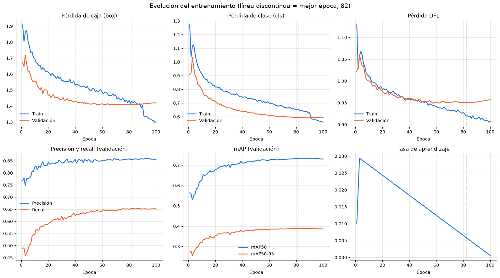
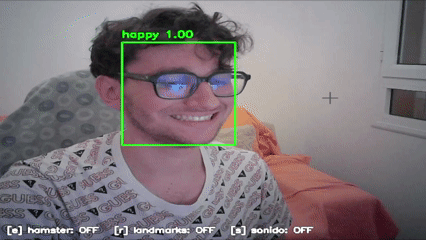
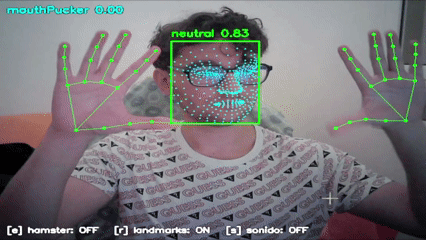
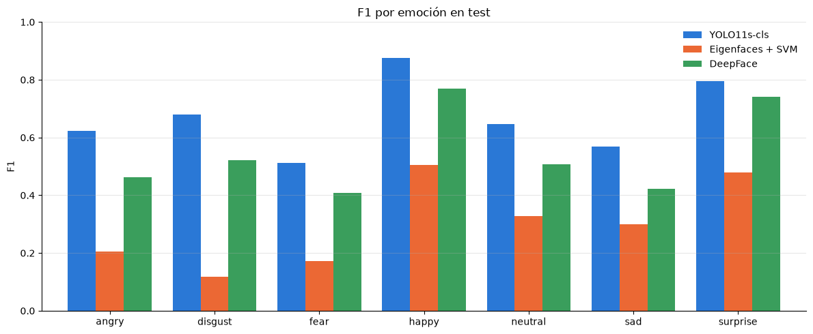
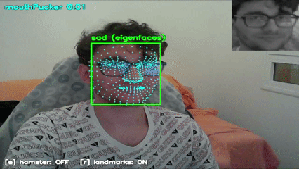
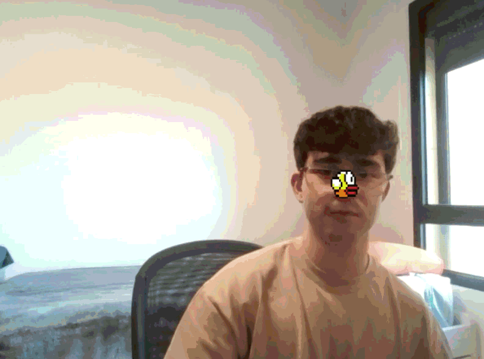
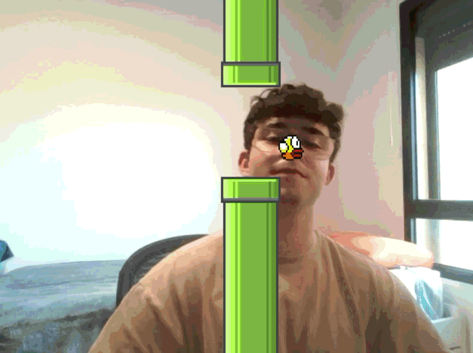

# Práctica 5. Biometría: Detección y caracterización de caras

## Práctica desarrollada por (Autoría):

- Juan Francisco Almeida Santana, [Github](https://github.com/kikoalmtana)
- Texenery Bordón Rodríguez, [Github](https://github.com/texem4k)

## Contenidos

- **Descripción de la práctica** 
- **Filtro con detector de emociones y gestos básicos** 
  - **Comparativa SVM+PCA, Yolo11s-cls y deepface**
- **Filtro con tracking de la nariz**
- **Uso de IA**

## Descripción  

La práctica 5 tiene como objetivo crear dos filtros o escenarios de aplicación usando información extraída del rostro mediante modelos de detección de caras y uno de ellos debe utilizar un modelo entrenado para la detección de información biométrica (por ejemplo, emociones).

En esta práctica se han desarrollado 2 filtros usando las tecnologías descritas en el guión de la práctica 5 y en prácticas anteriores los siguientes filtros:

- Un filtro que detecta emociones y en función a ellas muestra una imagen de un Hamster acorde a la emoción o gesto detectado
- Un filtro que trackeando la posición de la nariz te permite jugar una imitación del Flappy Bird

En este documento se muestra el desarrollo y se explica el código elaborado para ambos filtros


## 1. Filtro con detección de emociones y gestos básicos

El filtro coloca sobre la cara una imagen de un hámster que cambia según la emoción que se pone o el gesto que se hace con las manos. Cada vez que cambia la emoción o el gesto suena además un audio del hámster. El código está en [`emotion_detector.ipynb`](./emotion_detector.ipynb) y las funciones auxiliares (gestos, pegado de imágenes, sonidos) en [`utils.py`](./utils.py).

En cada frame de la webcam se usan **tres modelos**:

1. **YOLO11s** (Fine-tuning con WIDER FACE) localiza la cara.
2. **MediaPipe** (`HandLandmarker` y `FaceLandmarker`) obtiene los puntos de las manos y los *blendshapes* de la cara para reconocer gestos.
3. **YOLO11s-cls** (Fine-tuning con FER-2013) clasifica la emoción del recorte de la cara.

Si se reconoce un gesto, tiene prioridad sobre la emoción. Si no, se usa la emoción más probable del clasificador. La etiqueta elegida se elige al azar una imagen de `hamster/<etiqueta>/` y se pega sobre la caja de la cara. Solo se cambia de imagen cuando cambia la etiqueta.

### 1.1 Detector de caras: YOLO11s con WIDER FACE

El dataset de partida tiene **12.880 imágenes** con sus etiquetas en formato YOLO (una sola clase, `face`). La preparación fue:

- División aleatoria con semilla fija en **train / val / test = 70 / 15 / 15** (9.016 / 1.932 / 1.932 imágenes).
- Reescalado a **640x640 con *letterbox*** (se mantiene la relación de aspecto y se rellena con gris), ajustando las cajas a la nueva geometría.
- Limpieza de etiquetas: se recortan las cajas a los límites de la imagen y se descartan las de área nula (27 cajas), que Ultralytics marcaría como corruptas.

Se entrenó desde `yolo11s.pt` durante **100 épocas** (batch 8, AMP, sin volteo vertical porque no aporta en caras). Duró **11 h 47 min** en una RTX 3060 Laptop, y la mejor época fue la **82**.

| | Validación (época 82) | Test (`best.pt`) |
|---|---|---|
| Precisión | 0.855 | 0.851 |
| Recall | 0.654 | 0.603 |
| F1 | 0.741 | 0.706 |
| mAP50 | 0.733 | 0.679 |
| mAP50-95 | 0.390 | 0.359 |



La precisión es alta: cuando detecta una cara, casi siempre lo es. El recall es la principal limitación, porque se escapan las caras muy pequeñas o tapadas de las escenas con mucha gente. Para este filtro no es un problema, ya que con la cara grande y de frente de una webcam las confianzas están en 0.8-0.9.


### 1.2 Clasificador de emociones: YOLO11s-cls con FER-2013

FER-2013 tiene caras en gris de **48x48** con 7 emociones: *angry, disgust, fear, happy, neutral, sad, surprise*. Hay **28.709 imágenes de train** y **7.178 de test**. Está muy desbalanceado: *disgust* tiene 436 imágenes de train, frente a las 7.215 de *happy*.

Se entrenó `yolo11s-cls.pt`, con estos ajustes:

- **50 épocas**, batch 64, `imgsz=48` (Ultralytics lo sube a 64, el múltiplo de 32 más cercano), AMP y paciencia de 10 épocas.
- *Data augmentation* por defecto de clasificación (volteo horizontal, RandAugment y *random erasing*) sin volteo vertical.
- Optimizador elegido automáticamente por Ultralytics (MuSGD).
- Duración: **47 min**. La mejor época fue la **48**, con una *accuracy top-1* de **0.689** y top-5 de 0.993.


La pérdida de validación se estanca a partir de la época 30 mientras la de train sigue bajando, así que con más épocas empezaría a sobreajustar.

`dataset_emociones` no tiene carpeta `val`, así que se usó **test como validación** para elegir `best.pt`.
#### Prueba en demo



### 1.3 Gestos (emotes)

Los gestos se detectan con reglas geométricas sobre los 21 puntos de cada mano de MediaPipe, usando la caja de la cara como referencia de posición y escala. Un dedo cuenta como extendido si la distancia muñeca-punta supera 1,15 veces la distancia muñeca-nudillo central (PIP). Esta comparación no depende de la rotación de la mano.

| Gesto | Cómo se detecta |
|---|---|
| `thinking` | Dos manos juntas o cruzadas, o las yemas de los índices tocándose |
| `meh` | Dos palmas abiertas, una a cada lado de la cara y por debajo de los ojos |
| `bah` | Índice levantado junto a la boca o la barbilla, con el resto de dedos doblados |
| `actually` | Índice extendido apuntando hacia arriba |
| `thumbs up` / `thumbs down` | Puño con el pulgar en vertical, por encima o por debajo de los nudillos |
| `workout` | Puño cerrado a la altura de la cabeza y a un lado de la cara (bíceps) |
| `kiss` | *Blendshape* `mouthPucker` > 0.60 del `FaceLandmarker` (morritos) |

Si se cumplen varios gestos a la vez, gana el primero de la tabla. Para evitar parpadeos, un gesto solo se activa si aparece en más de la mitad de los últimos 6 frames **(votación por mayoría)**.
#### Prueba en demo



### 1.4 Sonidos y controles

Con cada cambio de etiqueta suena un audio aleatorio de `hamster_sounds/<etiqueta>/`. Entre dos sonidos pasan al menos 8 s y cada uno se corta a los 6 s. El sonido empieza silenciado.

- `e`: mostrar u ocultar el hámster
- `r`: mostrar u ocultar los *landmarks* de MediaPipe
- `s`: activar o silenciar el sonido
- `ESC`: salir

### 1.5 Comparativa SVM+PCA, YOLO11s-cls y DeepFace

Para valorar el clasificador de emociones se compara con otros dos:

- **Eigenfaces (PCA) + SVM**, el método clásico visto en clase, entrenado por nosotros en [`VC_P5_eigenfaces_emociones.ipynb`](./VC_P5_eigenfaces_emociones.ipynb).
- **DeepFace**, con su modelo de emociones preentrenado (`DeepFace.analyze(actions=['emotion'])`).

La comparativa está en [`VC_P5_deepface_analyze.ipynb`](./VC_P5_deepface_analyze.ipynb).

#### Entrenamiento de Eigenfaces + SVM

Con el fin de simplificar, se ha reutilizado gran parte del cuaderno original `VC_P5_eigenfaces_handcrafted_kfold.ipynb` pero realizando ajustes para adaptarlo a un clasificador de emociones.

**1) K-fold de descriptores.** Primero se compararon varios descriptores con un *5-fold* estratificado. Con un SVM con kernel `RBF` y `GridSearch` (tal y cómo estaba originalmente), el dataset completo tardaría horas, así que se usó un submuestreo de **500 imágenes por clase** (3.436 en total, porque *disgust* solo tiene 436). El SVM usa `class_weight='balanced'` y un GridSearch con `C ∈ {1e3, 5e3}` y `gamma ∈ {1e-4 … 1e-2}`.

| Descriptor + clasificador | Precisión (macro) | Recall (macro) |
|---|---|---|
| Píxeles + KNN (k=5) | 0.234 | 0.235 |
| PCA + KNN | 0.230 | 0.236 |
| **PCA + SVM** | **0.288** | **0.292** |
| HOG (4x4) + SVM | 0.341 | 0.345 |
| LBP (3x3, `nri_uniform`) + SVM | 0.336 | 0.339 |
| Stacking (PCA + HOG + LBP) | 0.386 | 0.408 |

El PCA del 95 % de la varianza se queda con unas 216 componentes de las 2.304 que tiene cada imagen. Ninguna combinación pasa del 41 %. Los descriptores locales (HOG, LBP) funcionan mejor que PCA porque describen bordes y texturas de zonas concretas de la cara, mientras que PCA trabaja con la imagen entera.

**2) Modelo final.** Se entrenó un único pipeline **PCA (95 %) → MinMaxScaler → SVC RBF** con **todo el train (28.709 imágenes)**. Se reutilizaron los hiperparámetros que eligió el GridSearch para PCA+SVM en 4 de los 5 folds (`C=1000`, `gamma=0.0001`). El modelo resultante tiene **257 componentes** y **27.467 vectores soporte**, es decir, el 96 % de las muestras de train. Eso indica que el SVM apenas consigue separar las clases en el espacio de eigenfaces. El modelo se guarda en `models/eigenfaces_svm.joblib`.


Las primeras eigenfaces recogen sobre todo la iluminación (la 1 explica el 28,9 % de la varianza), la pose y la forma de la cara, no la expresión.

#### Evaluación en test

Los tres modelos clasifican las mismas **7.178 imágenes de `dataset_emociones/test`**. En DeepFace se usa `detector_backend='skip'`, porque las caras ya vienen recortadas, así que solo se compara el clasificador.

| | YOLO11s-cls | Eigenfaces + SVM | DeepFace |
|---|---|---|---|
| Accuracy | **0.688** | 0.333 | 0.564 |
| Precisión (macro) | **0.687** | 0.308 | 0.568 |
| Recall (macro) | **0.664** | 0.352 | 0.534 |
| F1 (macro) | **0.672** | 0.301 | 0.547 |
| ms / imagen | **0.5** (GPU, lotes de 256) | 6.5 (CPU) | 12.7 (GPU) |

F1 por emoción:

| | YOLO11s-cls | Eigenfaces + SVM | DeepFace |
|---|---|---|---|
| angry | **0.622** | 0.204 | 0.462 |
| disgust | **0.680** | 0.118 | 0.521 |
| fear | **0.511** | 0.173 | 0.408 |
| happy | **0.877** | 0.506 | 0.769 |
| neutral | **0.647** | 0.328 | 0.508 |
| sad | **0.569** | 0.301 | 0.422 |
| surprise | **0.795** | 0.478 | 0.741 |




#### Prueba SVM+PCA en demo



**Conclusiones**

- **YOLO11s-cls es el mejor en todas las emociones** y también el más rápido, porque clasifica por lotes en GPU. Su resultado está algo inflado porque se usó test para elegir la mejor época, aunque la diferencia con los demás es demasiado grande para explicarse solo por eso.
- **DeepFace queda en una posición intermedia (≈56 %)**, lo esperable para la CNN pequeña de FER-2013 que usa. Comete los mismos errores que YOLO: *happy* y *surprise* son fáciles, mientras que *fear*, *sad* y *angry* se confunden entre sí. Su modelo también se entrenó con FER-2013, así que su cifra en test puede estar algo inflada.
- **Eigenfaces + SVM (≈33 %) está muy por debajo**. PCA compara píxeles en bruto y capta sobre todo la iluminación, la pose y la identidad, no los pequeños cambios de boca, cejas y ojos que definen una emoción. Además, `class_weight='balanced'` hace que prediga *disgust* demasiadas veces (recall 0.54, pero precisión 0.07).

## 2. Filtro con tracking de la nariz

### Tracking de la nariz

Para elaborar este filtro lo primero es poder trackear la poscion de la nariz en tiempo real, y se ha elegido para esta tarea el Face Landmarker de Mediapipe, un modelo que devuelve una malla de 478 puntos de la cara y que nos permite seleccionar que puntos específicos queremos trackear, por lo que le podemos decir al modelo que nos de específicamente los puntos relativos al contorno de la nariz.

El primer paso sería sencillamente inicializar el modelo y incializar, por ejemplo, una lista con los puntos que nos interesan, para luego quedarnos únicamente con ellos:

```python
# INICIALIZACIÓN 

BaseOptions = mp.tasks.BaseOptions
FaceLandmarker = mp.tasks.vision.FaceLandmarker
FaceLandmarkerOptions = mp.tasks.vision.FaceLandmarkerOptions
VisionRunningMode = mp.tasks.vision.RunningMode

latest = None  

def on_result(result, output_image, timestamp_ms):
    global latest
    latest = result

options = FaceLandmarkerOptions(
    base_options=BaseOptions(model_asset_path="face_landmarker.task"),
    running_mode=VisionRunningMode.LIVE_STREAM,
    num_faces=1,
    output_face_blendshapes=True,
    result_callback=on_result,
)

nose_indices = (
    1, 2, 4, 5, 6, 19, 45, 48, 64, 94, 97, 98,
    115, 168, 195, 197, 220, 275, 278, 294, 326, 327, 344, 440
)

...

cap = cv2.VideoCapture(0)
with FaceLandmarker.create_from_options(options) as landmarker:
    while True:
        ret, frame = cap.read()
        if not ret:
            break

        rgb_frame = cv2.cvtColor(frame, cv2.COLOR_BGR2RGB)
        mp_image = mp.Image(image_format=mp.ImageFormat.SRGB, data=rgb_frame)
        landmarker.detect_async(mp_image, int(time.time() * 1000))

        if latest is not None:
            h, w = frame.shape[:2]

            for face in latest.face_landmarks:
                h, w = frame.shape[:2]
                points = np.array(
                    [(face[i].x * w, face[i].y * h) for i in nose_indices],
                    dtype=np.float32,
                )

                # calcular centro de la nariz
                (center_x, center_y), radius = cv2.minEnclosingCircle(points)
```

En el código lo que observamos es como se inicializan los parámetros del modelo (en el directorio del proyecto se encuentra el fichero `face_landmarker.task`) y posteriormente en el bucle donde se captura la cámara, nos quedamos con los puntos que nos interesan (**points** = np.array([(face[i].x * w, face[i].y * h) **for i in nose_indices**], dtype=np.float32,)) y posteriormente calculamos el punto medio entre los puntos seleccionados, determinamos que ese es el punto medio de la nariz y es donde se colocará el png del pájaro de Flappy Bird.



## Aparición de tuberías en la partida

Ya implementado el pájaro, queda por añadir las tuberías al filtro, de forma que vayan saliendo consecutivamente y dejen huecos a diferentes alturas, para ello se ha implementado una clase `pipe_manager` con los siguientes atributos y métodos:

- PipeManager se inicializa con valores de spawn_interval (determina cada cuantos segundos se dibuja una tubería), speed (velocidad de las tuberías de px/s), pipe_width (ancho de la tubería), gap_height (margen del hueco entre la tubería de arriba y abajo con los bordes de la imagen), margin (espacio entre la tubería de arriba y de abajo), y se le pasa por parámetros al constructor el alto y el ancho de la ventana y la ruta a la imagen de la tubería.

    El método constructor de la clase, también inicializa una lista con todas las tuberías que hay en la imagen `pipes`, una variable `last_spawn` que determina cuando apareció la última tubería y una variable `last_update` que indica la última vez que se actualizó la imagen.

    Además, el método constructor calcula una variable llamada `spacing` que representa el espaciado entre tuberías, que debe ser constante y se calcula como la velocidad multiplicada por el intervalo de spawn y almacena la velocidad en otra variable llamada `base_speed`

- `make_pipe` es un método de la clase PipeManager que se encarga de construir una imagen de una tubería con una altura que se le pasa por parámetro.

- `spawn` es un método de la clase PipeManager que se encarga de crear una tubería nueva y añadirla a la lista pipes, para ello llama a make_pipe para crear la tubería superior e inferior, y calcula la posición del agujero de forma aleatoria respetando los márgenes definidos.

    La lista pipe almacena diccionarios del siguiente formato:

    ```python
    {
        "x": 640.0,
        "gap_y": 180,
        "top_img": ...,
        "bottom_img": ...,
        "passed": False,
    }
    ```

    De forma que la lista almacena la posición en x del obstáculo (entendiendo el obstáculo como las dos tuberías), el punto en el eje y donde se empieza el hueco (gap_y), sus imagenes, y un booleano que determina si el jugador pasó el obstáculo o no.

- `update` es un método de la clase PipeManager que se encarga de actualizar la posición en pantalla de cada tubería que se encuentra en pipes, desplazandola en el eje x en función del valor de speed y la diferencia de tiempo entre el instante actual y la última actualización.

    Además es este método quien se encarga de hacer aparecer las tuberías nuevas en función del valor de spawn_interval.

- `draw` es un método de la clase PipeManager que se encarga de dibujar en pantalla las tuberías que se encuentran en pipes en el frame que se le pasa por parámetro.

- `setSpeed` es un método de la clase PipeManager que se encarga de cambiar la velocidad a la que avanzan las tuberías, por tanto, también cambia el spawn_interval (si no lo hiciera, las tuberías no saldrian al mismo ritmo pese a ir más rápido, daría la impresión de que salen menos pero pasan más rápido).

    El nuevo valor de spawn_interval se calcula como la división entre el espaciado y la velocidad actual.

- `reset` es un método de la clase PipeManager que se encarga de resetear los valores del objeto PipeManager a su valor original (la lista pipes, la velocidad, y actualiza los valores de last_spawn y last_update).

Para usar esta clase simplemente se crea una instancia de PipeManager y se llama a update() y a draw(frame) dentro del bucle while.



## Colisiónes con tuberías y sistema de puntos

Una vez contamos con las tuberías en la escena necesitamos contar puntos cuando pasamos entre dos tuberías y determinar que la partida terminó si chocamos con una, para ello vamos a implementar otra clase en python `GameManager`:

- La clase inicializa los valores de socre, bestScore, gameOver (un booleano para determinar si la partida está en curso o no), la velocidad máxima y el incremento de velocidad por punto (se inicializan en 400 y 7, respectivamente).

    Al constructor de la clase se le pasa por parámetro un objeto de tipo PipeManager.

- Para determinar si se ha pasado una tubería o no, se implementa un método `passPipes`, este método recibe por parámetro la posición en el eje x del pájaro en el frame actual, y comprueba para cada tubería que no se halla pasado ya, si ha quedado por detrás del pájaro o no (pipe["x"] < x).

    Si es así, se incrementa un punto en score y en bestScore (si score >= bestScore) y se llama al método `setSpeed` del PipeManager para ajustar la velocidad.

- Para la detección de colisiones se implementa un método estático `detectCollision`, al que se le pasa por parámetro la posición en x e y del pájaro, el radio que abarca su circunferencia y sus márgenes de la tubería con la que se compara (arriba, abajo, izquierda y derecha), calcula el punto más cercano en x y en y de la tubería al pájaro, se determina que hubo colisión cuando este punto es más cercano centro de la hitbox del pájaro que cualquier punto del radio.

    Luego, se ha implementado otro método `checkCollisions` que se encarga de llamar para cada obstáculo en pipes, a `detectCollision` para la tubería superior e inferior, y devuelve true si colisiona con alguna y false si no lo hace con ninguna.

Luego en el código que teníamos antes sencillamente debemos instanciar un objeto de tipo GameManager, pasándole por parámetro el PipeManager que instanciamos previamente y debemos hacer unas modificaciones:

- Ahora sólamente llamamos al método update del PipeManager si la partida no ha terminado (if not game.gameOver) para detener el movimiento de las tuberías al final de la partida

- Cada vez que calculamos la posición del pájaro en el frame, justo después debemos comprobar si ha habido alguna colisión, y si es así terminar la partida, si no, llamamos al método passPipes del GameManager

    ```python
    ...

    (center_x, center_y), radius = cv2.minEnclosingCircle(points)

    ...

    if game.checkCollisions(center_x, center_y, radius):
        game.gameOver = True
    else:
        game.passPipes(x)
    ```

Como indicadores visuales, se añade al principio del bucle while dos textos:

1) Uno que indica la puntuación actual
2) Otro que indica la mejor puntuación alcanzada

En caso de colisión, además, aparece un texto indicando que la partida ha acabado y que puede reiniciar la partida apretando el espacio en su teclado (y por tanto se reinician los valores del PipeManager, la puntuación y el valor de gameOver)


## Datasets usados

- [WIDER FACE for YOLO (Para detector de caras)](https://www.kaggle.com/datasets/lylmsc/wider-face-for-yolo-training)
- [Hámster, (recogido a mano)](https://drive.google.com/file/d/145PJbvVxZh81FnwlnNA7bkNlE9ihglpk/view?usp=sharing)
- [FER-2013 (Para clasificador de emociones)](https://www.kaggle.com/code/shivambhardwaj0101/emotion-detection-fer-2013/notebook)

## Referencias

- [Detección y predicción en Ultralytics](https://docs.ultralytics.com/es/tasks/detect)
- [Como usar un clasificador de Ultralytics](https://docs.ultralytics.com/es/tasks/classify)
- [Referencias para extraer los Landmarks correspondientes de la nariz](https://www.sanderdesnaijer.com/blog/mediapipe-face-mesh-landmarks)

## Uso de IA

- [Conversación con Claude para asistencia en el desarrollo de Flappy Bird y sus clases de gestión](https://claude.ai/share/8ddf6b5e-7dac-4fda-b07c-a11a3e001768)
- [Sesión de Claude Code para verificar código, validar ajustes de entrenamiento y adición de gráficas del entrenamiento (Requiere cuenta de Claude)](https://claude.ai/code/cshk_015MkJMe8YhSyoa2go81S8Mc3m9dgghiSZczXjWYYVNB4C)
